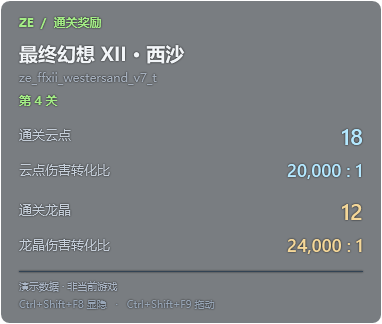

# ZE 奖励悬浮窗

个人自用的 Windows 桌面工具。读取风云社广播助手实时文件，根据 ZE 地图名称与当前关卡显示通关奖励。



## 功能

- 显示当前关卡的通关云点、云点伤害转化比、通关龙晶和龙晶伤害转化比。
- 每 600 毫秒读取广播文件；奖励按地图与绝对关卡编号精确匹配。
- 透明置顶悬浮窗，支持拖动、位置保存和锁定后鼠标穿透。
- 可设置全局快捷键、背景不透明度、整体显示大小和输入文件路径。
- 从风云社公开配置获取奖励；网络失败时使用带时间标记的本地缓存。
- 非 ZE 地图、没有地图/关卡信息或奖励缺失时，显示「当前无法获取该地图信息」。

## 运行和构建

环境：Windows 10/11，.NET 10 SDK（构建）或 .NET 10 Windows Desktop Runtime（运行构建产物）。

在项目目录运行 PowerShell：

```powershell
dotnet run --project .\tests\Overlay.Tests.csproj -c Release
dotnet publish .\src\FysZeRewardOverlay.csproj -c Release --no-self-contained -o .\app
.\app\FysZeRewardOverlay.exe
```

构建输出在 `app/`，不提交到 Git。复制运行时请保留该目录内的配套文件。更新已有程序前，先从系统托盘退出正在运行的实例。

| 操作 | 默认快捷键 |
| --- | --- |
| 显示 / 隐藏 | Ctrl + Shift + F8 |
| 拖动 / 锁定 | Ctrl + Shift + F9 |
| 打开设置 | Ctrl + Shift + F10 |

右键系统托盘图标也可打开设置、恢复位置、刷新奖励和退出。CS2 建议使用无边框窗口或普通窗口；独占全屏可能覆盖桌面悬浮窗。

## 数据来源

- 实时输入：`%LOCALAPPDATA%\fys\fys.broadcast.assistant.txt`，只读。
- 官方奖励：[fyscs/cs2 — 2001/sharp/configs/rewards](https://github.com/fyscs/cs2/tree/master/2001/sharp/configs/rewards)。
- 本机设置和缓存：`%LOCALAPPDATA%\FysZeRewardOverlay`。

这里只显示公开配置的基础奖励，服务器同步、个人加成和活动倍率可能影响实际结算。广播文件未提供有效关卡时不会猜测关卡，也不会默认沿用上一张地图的奖励。游戏内 ZE 实测尚待完成。

## 项目内容

- `src/`：C# / WPF 程序。
- `tests/`：31 项解析、匹配、缓存、异常处理和设置测试。
- `samples/`：独立测试输入，避免改写真实广播文件。
- `docs/images/`：程序自身渲染的示例界面。
- [使用说明](使用说明.md)：详细操作、数据处理和诊断方式。

个人设置、运行缓存、日志和本机测试产物已列入 `.gitignore`。
